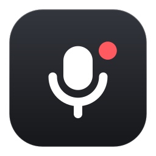
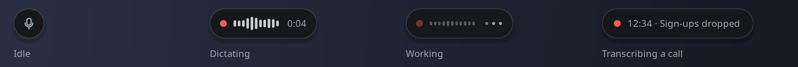
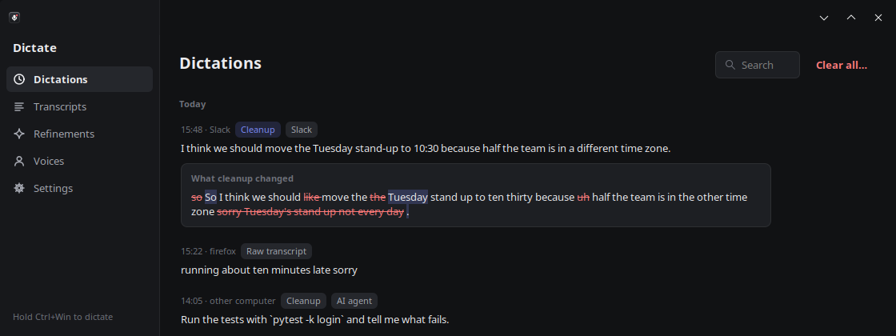
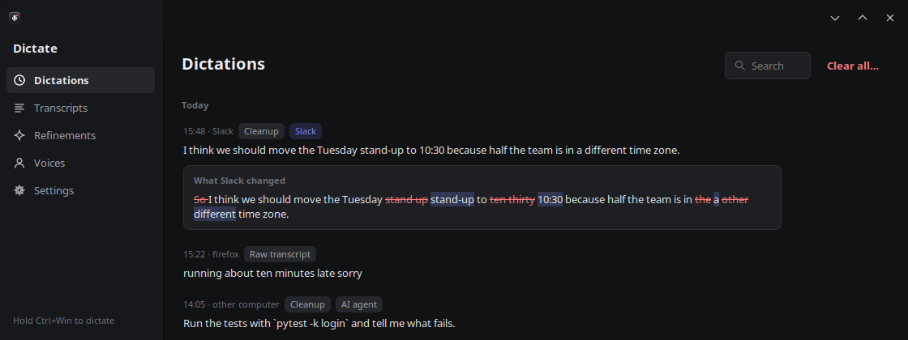
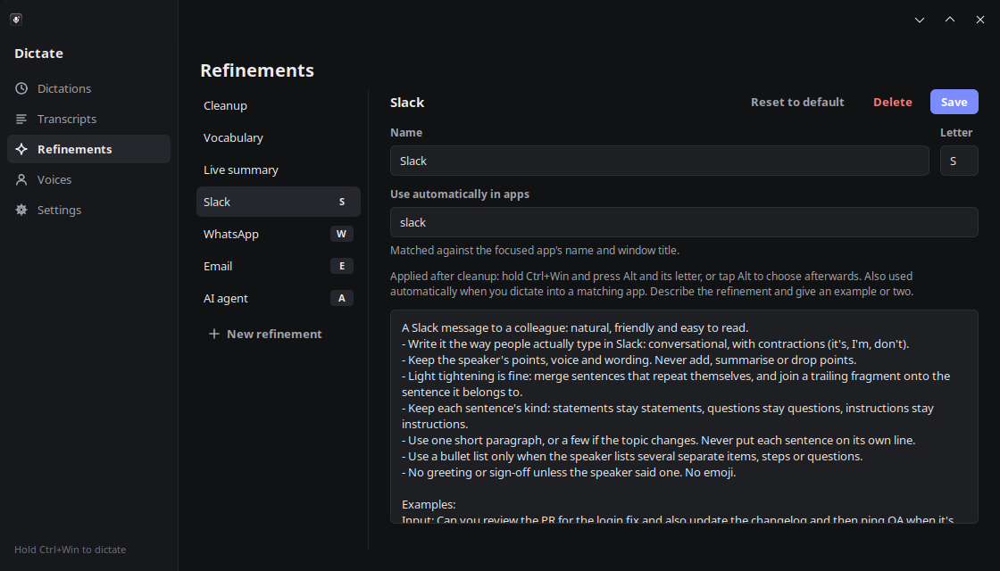
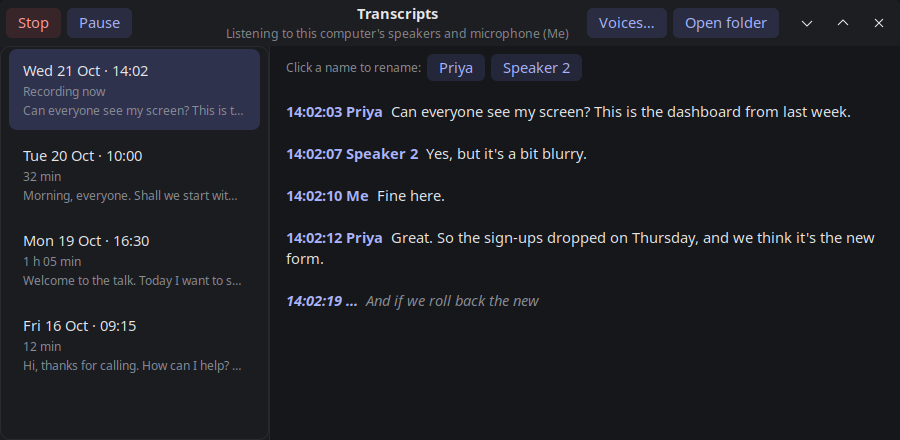
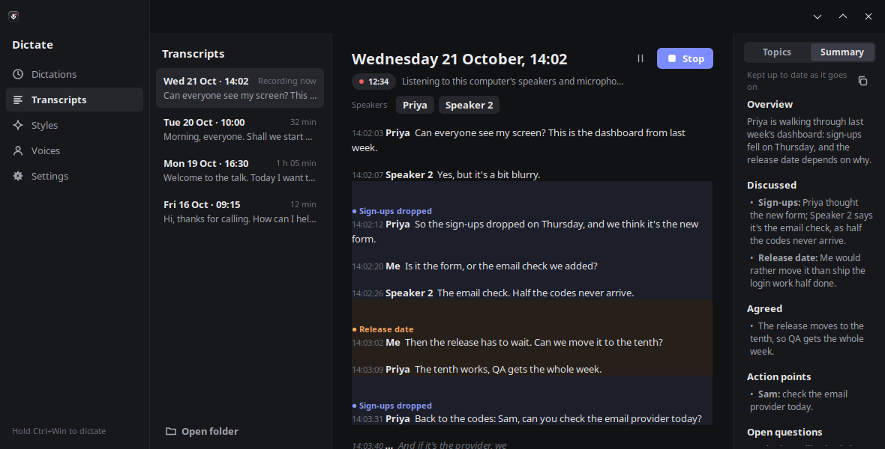
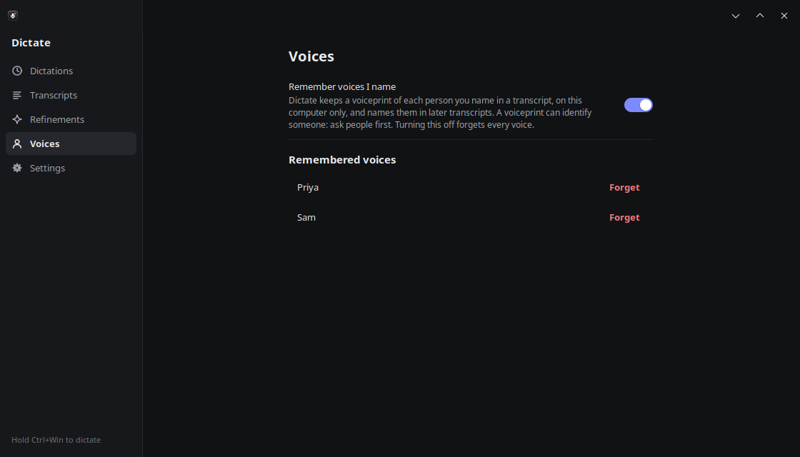
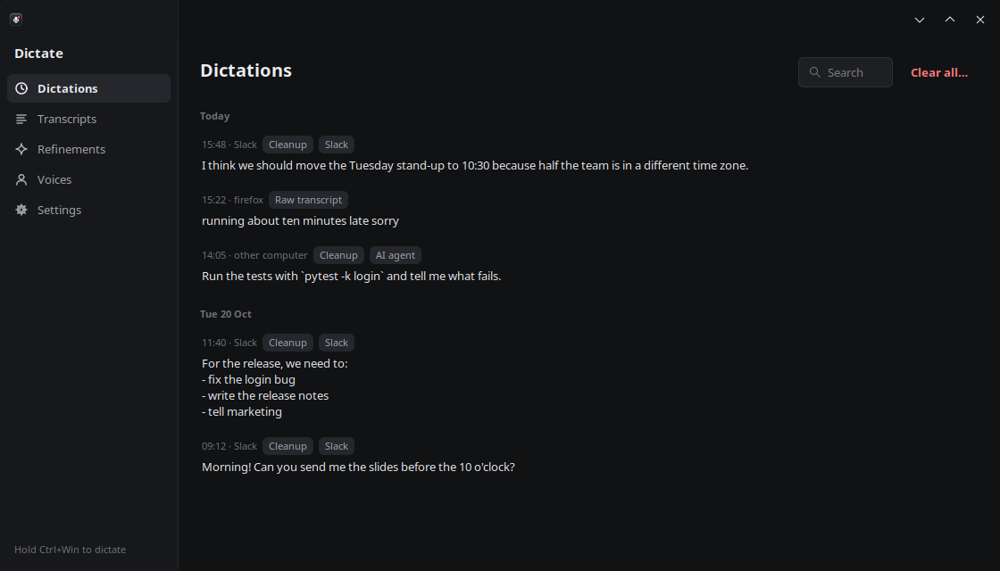
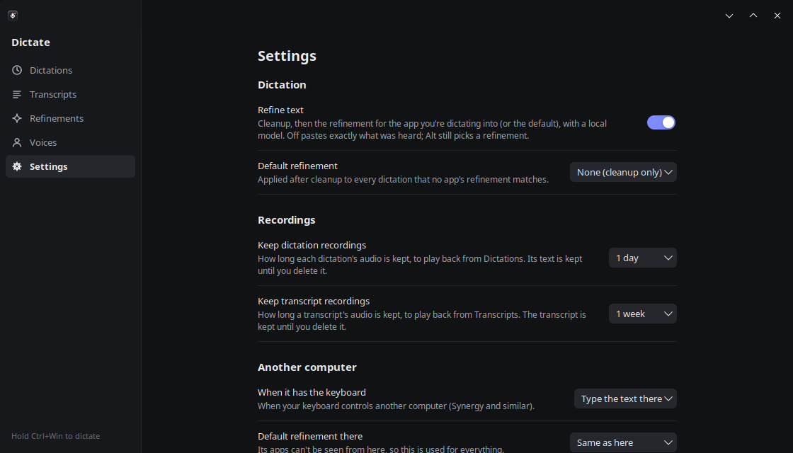

# Dictate

Dictate is push-to-talk dictation for the desktop. Hold Ctrl+Win, speak, and let go: the text is cleaned up,
refined for the app you're typing in, and pasted there. It can also transcribe calls as they happen, telling the
speakers apart and keeping a live list of topics and a summary.

Everything runs on your own computer, and nothing you say leaves it ([how to check](docs/TECHNICAL.md#checking-that-its-local-only)).



## Get started

On Linux (SteamOS / KDE Plasma, or Ubuntu 24.04+):

```sh
git clone https://github.com/searbe/dictate.git
cd dictate
./setup.sh
python dictate.py
```

Setup downloads the models (about 10 GB) into this folder, and everything stays in it: delete the folder and
Dictate is gone. Tick **Run at startup** in its menu to have it there every time you log in. Windows and macOS
setups are included but untested; see [the technical details](docs/TECHNICAL.md) for those, and for the
recommended hardware.

## Automatic cleanup and refinement

Every dictation is cleaned up first: filler words, repeated words and false starts are removed, corrections
you make as you speak are applied, and words the speech recognition misheard are fixed. Your wording is kept.

Each dictation is kept in a list, where you can see what each step changed. Here, **Cleanup**:



We write differently in different contexts. **Refinements** take the cleaned-up text and rewrite it for the
application you're typing in, following your own instructions: a Slack refinement for Slack, an email one for your
mail client, matched by app name or window title. The same dictation, after the Slack refinement:



To use a different refinement for one dictation, tap **Alt** while you speak and pick one when you let go, or
press its letter with Alt (**Alt+S**, **Alt+E**…). Refinements are written in plain language and you can add your
own. **Vocabulary** holds names and terms, spelled the way you spell them.

| Pick a refinement (tap Alt while dictating) | Your refinements |
|---|---|
|  |  |

## Live call transcription, with topics and a summary

Hold Ctrl+Win, lift Win and press it again, and Dictate transcribes what your computer plays and what you say
into your microphone: a Meet or Zoom call, a webinar, a podcast.

- **Speakers.** Each voice is told apart word by word, so a short "yeah" in the middle of someone else's
  sentence is attributed to whoever said it. Click a name to rename that speaker.
- **Topics.** Updated about every 20 seconds: each topic has its own colour, who raised it and what was said, and
  the current one is marked. The transcript is tinted in the same colours. Click a topic to go to it.
- **Summary.** An overview, what was discussed and by whom, what was agreed, action points and open questions,
  updated about every 30 seconds and given a final pass when you stop. The prompt can be changed.
- **Echo.** Without headphones, your microphone also picks up the call from your speakers. Dictate detects this
  and leaves it out, so the other side isn't written down a second time as you.
- **Playback.** Click a paragraph's time to play the recording from there.

| Topics, as the call goes on | The live summary |
|---|---|
|  |  |

Transcripts are saved as Markdown files, with the summary and topics at the top.

## Voice recognition (opt-in)

With **Remember voices** turned on, a speaker you name in a transcript is recognised and named in later calls.
It's off by default, the voiceprints are stored only on this computer, and turning it off deletes them all. A
voiceprint can identify someone, so ask people first.



## The capsule and the Dictate window

On the desktop, Dictate is a small capsule: a dot while idle, a level meter while you speak, three dots while
the text is processed, and the elapsed time and current topic while a call is transcribed (click it to open the
transcript). If you close the window during a call, or nothing is heard for ten minutes, a reminder appears
beside the capsule saying it's still transcribing and how to stop it.

Everything else is in one window: **Dictations** (with recordings to play back), **Transcripts**,
**Refinements**, **Voices** and **Settings**. It follows your desktop's light or dark theme.

| Every dictation, and what was done to it | Settings |
|---|---|
|  |  |

## Local only

Speech recognition, cleanup, refinements, topics, summaries and voice recognition all run locally, on the
graphics card when it's free and on the processor otherwise. There's no account and no cloud service. The models
are downloaded once, during setup; after that Dictate makes no network connections.

`python scripts/prove_local.py` checks this: it runs Dictate in a sandbox with no network, records every network
call made by any of its processes, and reports `LOCAL ONLY` only if none left the computer.

## Speed

Speech is transcribed while you talk, so the text is ready about a tenth of a second after you let go. Cleanup
takes about a second on a graphics card, or 1–2 seconds on a recent processor. The model is loaded while you're
speaking and unloaded after 30 seconds unused, so it doesn't hold the graphics card while you game.

## Keys

| | |
|---|---|
| **Ctrl+Win** (hold) | Dictate; let go to paste |
| **+ Alt** (tap, while holding) | Pick a refinement when you let go (Enter pastes as is, Esc only copies) |
| **+ Alt+letter** | Use that refinement |
| **+ any other key** | It's another app's shortcut (e.g. Ctrl+Win+→): nothing is pasted |
| **Ctrl+Win, then Win again** | Start or stop transcribing a call: hold Ctrl+Win, lift Win, press it again (or **Stop**, or the menu) |
| **Right-click the capsule** | The menu: refine text on or off, the default refinement, your dictations, transcripts and settings |

You can dictate as usual while a call is being transcribed; your dictations stay out of the transcript. On Linux,
terminals get Ctrl+Shift+V. While your keyboard controls another computer through Synergy or similar, the text is
typed there instead.

## More

- [The technical details](docs/TECHNICAL.md): how it works, hardware, setup on each platform, the code, your data.
- [Testing](docs/TESTING.md) and [the design system](docs/design/DESIGN.md), for changing it.

MIT licensed: see [LICENSE](LICENSE). The models it downloads have their own licenses, listed in
[the technical details](docs/TECHNICAL.md#licenses).
