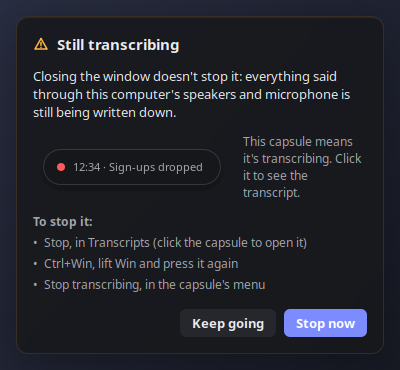

# Dictate

Push-to-talk dictation that runs entirely on your own computer. Hold a hotkey and speak; when you let go, the transcribed and cleaned-up text is pasted into the app you're typing in. Built for Linux (SteamOS / KDE Plasma), and also sets up on Ubuntu 24.04+; Windows and macOS support is included but untested.

## Features
- **Hotkey dictation:** hold **Ctrl+Win** (Ctrl+Cmd on a Mac), speak, release to paste.
- **Local speech recognition:** Parakeet TDT 0.6B on the CPU, transcribing as you speak.
- **Clean-up:** a local language model (Qwen3.5) removes filler words, applies self-corrections and fixes punctuation and mis-heard words. It uses the GPU when one is free, otherwise the CPU.
- **Refinement styles:** reformat for Slack, WhatsApp, email or AI agents, or your own styles. Pick one per dictation, set a default, or match styles to apps automatically.
- **Vocabulary:** names and terms you use, spelled the way you spell them.
- **Transcribe mode** (Linux): transcribes your computer's audio and your microphone, e.g. a call, telling the voices apart and listing the topics as they come up.
- **Dictations:** every dictation with what was applied, playback of the recording, copy, delete and clear. Recordings are kept for a time you choose.
- **Synergy:** while your keyboard is controlling another computer, the text is typed there.
- **A small capsule** that stays out of the way: a dot until you dictate, then a live level meter; a system tray icon with the same menu; one **Dictate** window for your dictations, transcripts, styles, voices and settings.
- **Self-contained:** everything installs into this folder. Dictate sends nothing over the network; models are downloaded once, during setup. [Check it yourself](#checking-that-its-local-only).

## Using it
Hold **Ctrl+Win** to record, release to transcribe and paste into the focused text box.
- **Tap Alt** while holding: pick a refinement style when you let go (its letter; Enter pastes as is, Esc only copies).
- **Alt+letter** while holding (e.g. Alt+S): use that style directly.
- **Any other key** while holding (e.g. Ctrl+Win+→ to switch desktop) makes it that app's shortcut: the recording is dropped.
- **Default style** (menu): used for every other dictation. "None" means cleanup only.
- **Per-app styles:** a style can be used automatically in apps whose name or window title matches (e.g. "slack").
- **Vocabulary** (Styles): names and terms, spelled your way.
- **Refine text** (menu): off gives the raw transcript, fastest.
- **Synergy and similar:** while your keyboard controls another computer, the text is typed there. **When another computer has the keyboard** (menu) sets its style, or ignores the hotkey.
- On Linux, terminals get Ctrl+Shift+V instead of Ctrl+V.

**Transcribe mode** (Linux) transcribes your computer's audio and your microphone, e.g. a call.
- **Start / stop:** hold Ctrl+Win, lift Win and press it again. Or use **Stop**, or the menu.
- People are labelled "Speaker 1", "Speaker 2"… Click a name to rename them; naming two the same merges them.
- The topics are listed beside the transcript, each in its colour, with who brought it up; the one being talked about now is marked. Click one to go to it. While the graphics card is busy, a smaller, less reliable model finds them (a warning says so) until it's free again.
- You can dictate as usual while it runs; your dictations stay out of the transcript.
- **Transcripts** (menu) lists them all; the live one is at the top. Saved as Markdown in `data/transcripts/`; one where nothing was heard isn't kept. While its recordings are kept, **Play** plays the call, and clicking a paragraph's time plays from there.
- Closing the window doesn't stop it: the first time each day, and after 10 minutes with nothing heard, a reminder beside the icon says so and how to stop it (a desktop notification if the icon isn't on screen).
- **Voices** can remember the people you name, for next time (off by default; ask people first).

The capsule is a dot while idle; it grows to show a level meter while you dictate, three dots while the text is refined, and the elapsed time and topic while transcribing a call (click it then to see the transcript). Drag it to move it; right-click it, or the tray icon, for the menu.

**Dictations** lists every one: play it back, copy it or delete it. **Settings** has the rest, such as how long recordings are kept: dictations' and calls' separately, from not at all to forever (by default a day and a week; the text is kept until you delete it).


| Style picker (tap Alt while dictating) | Still transcribing |
|---|---|
|  |  |


How it's designed, and the rules for changing it: [docs/design/DESIGN.md](docs/design/DESIGN.md).

## Checking that it's local only
Don't take our word for it. On Linux, after setup, run:

```sh
python scripts/prove_local.py
```

It runs Dictate, with the real models, in a sandbox with no network, records every network call of every process,
and ends with `RESULT: LOCAL ONLY` only if they all stayed on this computer. `--live` does the same with your actual
Dictate, keyboard and microphone (quit Dictate first). It needs `bubblewrap` and `strace` (SteamOS has both; on
Ubuntu: `sudo apt install bubblewrap strace`).

## Recommended hardware
| | Minimum | Recommended |
|---|---|---|
| **CPU** | Any 64-bit x86 or Apple Silicon from the last ~6 years | 8 cores or more, if refining text on the CPU |
| **RAM** | 8 GB | 16 GB or more |
| **GPU** | None: everything can run on the CPU | 8 GB+ of free video memory (12 GB+ card), any Vulkan GPU on Linux, NVIDIA on Windows, or an Apple Silicon Mac with 16 GB+ |
| **Disk** | ~10 GB for the models | SSD, so the models load quickly |
| **Microphone** | Built-in | A headset or close-up mic: the biggest single help in noisy rooms |

Transcription takes 0.1 s or less after you let go. Refining is the slow part: about 0.5–1.5 s with a free GPU
(tested on a Radeon RX 9070 XT), 1–2 s on a recent 8-core CPU, longer on laptops.

## Setup (self-contained)
Each setup script installs into this folder and nothing anywhere else, and is safe to re-run:
- `models/`: Parakeet TDT 0.6B v3 (~640 MB, speech), Silero VAD, TitaNet small (40 MB, voices), and Qwen3.5 4B (~2.7 GB, CPU) and 9B (~5.7 GB, GPU) for refinement.
- `bin/llama/`: a llama.cpp release (Vulkan on Linux/Windows, Metal on macOS), used for refinement.
- `.venv/`: Python packages.
- `data/`: your history, recordings, settings, styles and vocabulary.

Delete the folder to remove the app completely.

### Linux (SteamOS / KDE Plasma): the main platform
`./setup.sh`, then `python dictate.py` (it switches to `.venv` automatically). It reuses the system's GTK and evdev bindings read-only.
If a SteamOS update breaks the app, run `./setup.sh` again; it rebuilds `.venv` for the new system Python.
To start it at login, tick **Run at startup** in the menu (adds `~/.config/autostart/dictate.desktop`; unticking removes it).
### Ubuntu 24.04+ / Debian
`./setup.sh` as above. On Ubuntu and Debian (and derivatives such as Mint and Pop!_OS) it first asks for your sudo password to:
- install the system packages SteamOS already ships, if missing: the GTK, evdev and dbusmenu Python bindings, `python3-venv`, PipeWire's `pw-record`/`pw-play`, and the Vulkan loader;
- add `/etc/udev/rules.d/70-dictate.rules`, if your session can't already read the keyboards and `/dev/uinput`. It gives the logged-in user access (as Steam's rules do on SteamOS); log out and back in if the hotkey doesn't work at once. This lets any program you run read your keyboard, which is how the global hotkey works.

Focused-app detection uses KWin, so per-app styles need KDE (Kubuntu); on GNOME everything else works, and the tray icon needs Ubuntu's AppIndicator extension (on by default). Tested in an Ubuntu 24.04 container (setup and transcription), not on a desktop.

Other distributions need the same pieces by hand: read access to `/dev/input/event*` and `/dev/uinput`, PyGObject with GTK 3, python-evdev, the dbusmenu GObject bindings, and PipeWire's `pw-record`/`pw-play`.

### Windows 10/11 (untested)
1. Install Python 3.14: `winget install -e --id Python.Python.3.14` (GTK's Python bindings are built for 3.14).
2. `powershell -ExecutionPolicy Bypass -File setup-windows.ps1`. This also downloads a GTK 3 runtime into `gtk\` (~300 MB, from [gvsbuild](https://github.com/wingtk/gvsbuild)).
3. Double-click `Dictate.lnk`. **Run at startup** in the menu adds or removes it from the login items (the per-user Run registry key).

Hold **Ctrl+Win**. The GPU model is used on NVIDIA cards with enough free memory (checked with `nvidia-smi`); otherwise refinement runs on the CPU.

### macOS (untested)
1. Install [Homebrew](https://brew.sh).
2. `./setup-mac.sh` (installs Python 3.14 and GTK 3 with Homebrew).
3. `.venv/bin/python dictate.py`

Hold **Ctrl+Cmd** (Option is Alt). There's no menu-bar icon on macOS (GTK 3 can't make one), so use the capsule's menu. **Run at startup** adds a LaunchAgent (`~/Library/LaunchAgents/local.dictate.plist`). macOS will ask for Microphone, Input Monitoring (hotkey) and Accessibility (paste) permissions for the app you launch it from; restart Dictate after granting them. Screen Recording is optional and lets per-app styles see window titles. Macs with 16 GB of RAM or more use the 9B model on the GPU (Metal).

## Code
- `dictate.py` starts the app; the app is the `dictate/` package (each module explains itself at the top):
  `app.py` (menu, dictation pipeline), `capsule.py`, `hub.py` and `transcripts_page.py` (the Dictate window),
  `huds.py` (picker, reminders, dialogs), `design.py` (the design system), `osio.py` (hotkey, recording, pasting
  per OS), `stt.py` (speech to text), `refine.py` (cleanup and styles), `transcript.py`, `voices.py`, `echo.py`
  and `topics.py` (transcribe mode), `remote.py` (another computer has the keyboard), `tray.py`, `activewin.py`.
- `scripts/`: `fetch.py` (downloads, used by setup), `test.py` (the tests: see [docs/TESTING.md](docs/TESTING.md)),
  `prove_local.py`, `bench.py` (compares refinement models), `bench_voices.py` (telling voices apart),
  `bench_topics.py` (topics on saved transcripts).
- `docs/make_screenshots.py`: regenerates the screenshots.

## Data
`data/` (not in git; `DICTATE_DATA` moves it): `dictations.jsonl`, recordings in `audio/` and `transcripts/`,
`styles.json`, `vocab.txt` and `state.json`. Logs go to `journalctl --user` when started from the desktop.

## License
MIT: see [LICENSE](LICENSE). The models and tools the setup scripts download come under their own licenses: [Parakeet TDT](https://huggingface.co/nvidia/parakeet-tdt-0.6b-v3), [Qwen3.5](https://huggingface.co/Qwen/Qwen3.5-9B), [Silero VAD](https://github.com/snakers4/silero-vad), [TitaNet](https://catalog.ngc.nvidia.com/orgs/nvidia/teams/nemo/models/titanet_small), [llama.cpp](https://github.com/ggml-org/llama.cpp), [sherpa-onnx](https://github.com/k2-fsa/sherpa-onnx) and, on Windows, [gvsbuild](https://github.com/wingtk/gvsbuild)'s GTK runtime.
