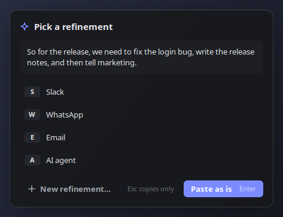
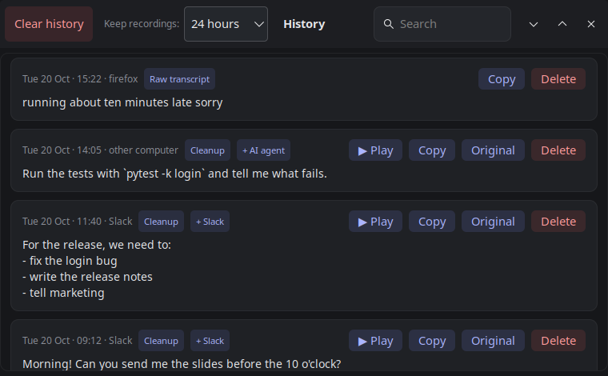
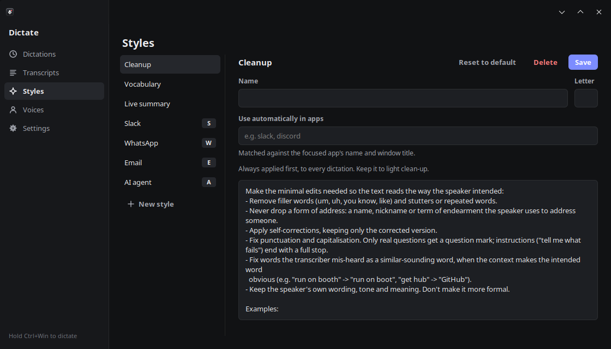

# Dictate

Hold **Ctrl+Win** (Ctrl+Cmd on a Mac) to record, release to transcribe and paste into the focused text box.
- **Tap Alt** while holding: when you let go, a window shows the cleaned-up text and asks which refinement style to apply (press its letter, Enter to paste as is, or Esc to only copy it).
- **Alt+letter** while holding (e.g. Alt+S): applies that style directly, with no window.
- **Default style** (right-click > Default style): a style applied to every plain Ctrl+Win dictation after cleanup. Choose "None" for cleanup only.
- **Per-app styles**: a style whose "Use automatically in apps" keywords match the focused app or window title (e.g. "slack") is used instead of the default. The app's name and title are also given to the model as context.
- **Vocabulary** (Refinement styles… > Vocabulary): names and terms you use, so cleanup spells them right and fixes mis-hearings.
- On Linux, terminals get Ctrl+Shift+V instead of Ctrl+V.

The floating dot is dark when idle, red with pulsing rings while recording, and shows a spinner while transcribing. Drag it to move it. Right-click it (or click the system tray icon) for Refine text, Default style, History, Refinement styles…, Run at startup and Quit.

| Style picker (tap Alt while dictating) | History |
|---|---|
|  |  |

## Setup (self-contained)
Each setup script installs into this folder and nothing anywhere else, and is safe to re-run:
- `models/`: Parakeet TDT 0.6B v3 int8 (~640 MB), the Silero VAD speech filter, and Qwen3.5 4B (~2.7 GB, CPU) and 9B (~5.7 GB, GPU) for refinement.
- `bin/llama/`: a llama.cpp release (Vulkan on Linux/Windows, Metal on macOS), used for refinement.
- `.venv/`: Python packages.
- `data/`: history, settings, and refinement styles (`data/styles.json`, managed via right-click > Refinement styles…).

Delete the folder to remove the app completely.

### Linux (SteamOS / KDE Plasma): the main platform
`./setup.sh`, then `python dictate.py` (it switches to `.venv` automatically). It reuses the system's GTK and evdev bindings read-only.
If a SteamOS update breaks the app, run `./setup.sh` again; it rebuilds `.venv` for the new system Python.
To start it at login, tick **Run at startup** in the menu (adds `~/.config/autostart/dictate.desktop`; unticking removes it).

### Windows 10/11 (untested)
1. Install Python 3.14: `winget install -e --id Python.Python.3.14` (GTK's Python bindings are built for 3.14).
2. `powershell -ExecutionPolicy Bypass -File setup-windows.ps1`. This also downloads a GTK 3 runtime into `gtk\` (~300 MB, from [gvsbuild](https://github.com/wingtk/gvsbuild)).
3. Double-click `Dictate.lnk`. **Run at startup** in the menu adds or removes it from the login items (the per-user Run registry key).

Hold **Ctrl+Win**. The GPU model is used on NVIDIA cards with enough free memory (checked with `nvidia-smi`); otherwise refinement runs on the CPU.

### macOS (untested)
1. Install [Homebrew](https://brew.sh).
2. `./setup-mac.sh` (installs Python 3.14 and GTK 3 with Homebrew).
3. `.venv/bin/python dictate.py`

Hold **Ctrl+Cmd** (Option is Alt). There's no menu-bar icon on macOS (GTK 3 can't make one), so use the floating icon's menu. **Run at startup** adds a LaunchAgent (`~/Library/LaunchAgents/local.dictate.plist`). macOS will ask for Microphone, Input Monitoring (hotkey) and Accessibility (paste) permissions for the app you launch it from; restart Dictate after granting them. Screen Recording is optional and lets per-app styles see window titles. Macs with 16 GB of RAM or more use the 9B model on the GPU (Metal).

## Code
- `dictate.py`: floating icon and the dictation pipeline
- `osio.py`: everything OS-specific: global hotkey, recording, paste and run-at-startup (evdev/pw-record/uinput on Linux, pynput/sounddevice on Windows and macOS)
- `stt.py`: transcription. The VAD strips non-speech, then Parakeet runs on the CPU.
- `windows.py`: History, the refinement style manager, and the style picker.
- `tray.py`: the system tray icon with the same menu (a StatusNotifierItem plus dbusmenu on KDE, GTK's status icon on Windows).
- `activewin.py` + `kwin_active.js`: tracks the focused window. On KDE, KWin loads the script at runtime and unloads it on exit; it's never installed. Windows and macOS ask the OS directly.
- `fetch.py`: downloads the models and the right llama.cpp build; used by every setup script.
- `bench.py`: compares every `models/*.gguf` on your recent dictations: `python bench.py`.
- `refine.py`: the default cleanup (toggle with right-click > Refine text), then any additional style on top. Pressing the hotkey (or Alt) starts loading the model: the larger GPU model if the GPU has enough free memory and is under 30% busy, otherwise the smaller CPU model (`MODELS` in refine.py). It's unloaded after 30 s of no use. History keeps the raw transcript as "Original".
